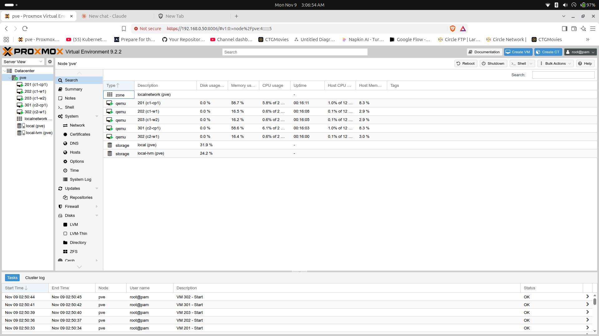
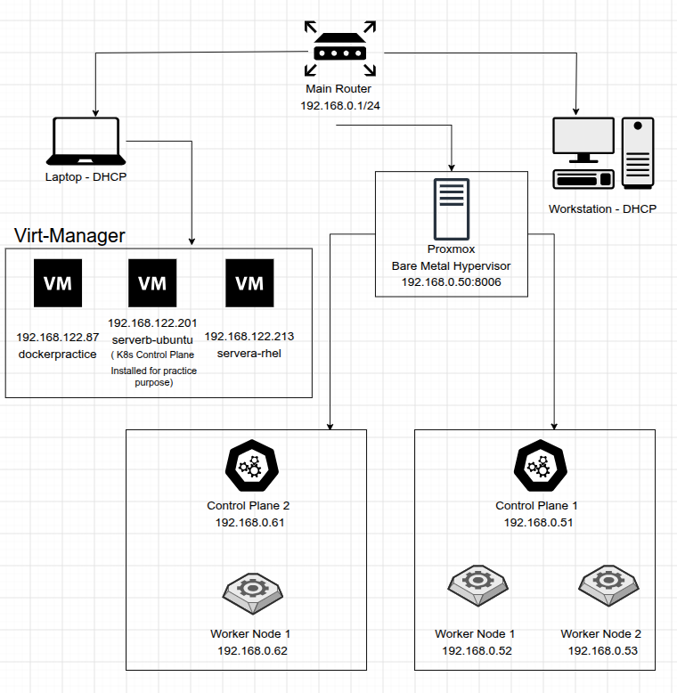
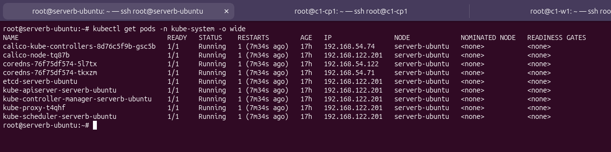
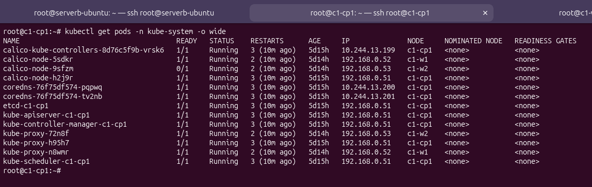
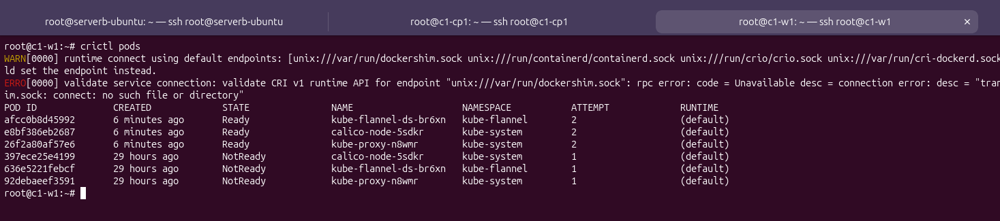

# Kubernetes (kubeadm) on Proxmox Lab

Step-by-step documentation of building Kubernetes clusters with **kubeadm** on **Proxmox VE** virtual machines. Written so the whole setup can be reused and rebuilt later.

## Lab environment

| Item | Value |
|---|---|
| Hypervisor | Proxmox VE 9.2.2 (node: `pve`) |
| Container runtime | containerd |
| Kubernetes install method | kubeadm |
| Kubernetes apt repo | `pkgs.k8s.io` `v1.29` |
| OS | Debian/Ubuntu (apt-based) |

### Clusters

| Cluster | VM ID | Hostname | Role |
|---|---|---|---|
| c1 | 201 | c1-cp1 | Control plane |
| c1 | 202 | c1-w1 | Worker |
| c1 | 203 | c1-w2 | Worker |
| c2 | 301 | c2-cp1 | Control plane |
| c2 | 302 | c2-w1 | Worker |

## Documentation

1. [Architecture](docs/00-architecture.md)
2. [Prerequisites on all nodes](docs/01-all-nodes-prerequisites.md)
3. [Control plane setup](docs/02-control-plane.md)
4. [Join worker nodes](docs/03-worker-nodes.md)
5. [Verification](docs/04-verification.md)
6. [Troubleshooting](docs/05-troubleshooting.md)
7. [TODO / improvements](docs/06-todo.md)

## Scripts

| Script | Run on | Purpose |
|---|---|---|
| [`scripts/01-all-nodes.sh`](scripts/01-all-nodes.sh) | All nodes | Kernel modules, sysctl, containerd, swap off, kubeadm/kubelet/kubectl |
| [`scripts/02-control-plane-flannel.sh`](scripts/02-control-plane-flannel.sh) | Control plane | `kubeadm init` + Flannel |
| [`scripts/02-control-plane-calico.sh`](scripts/02-control-plane-calico.sh) | Control plane | `kubeadm init` + Calico |
| [`scripts/03-useful-commands.sh`](scripts/03-useful-commands.sh) | Control plane | Verify cluster, create join command |

The original raw notes are kept in [`notes/K8s_Kubeadm_Setup_original.txt`](notes/K8s_Kubeadm_Setup_original.txt).

If you want a single node action -> 01 VM -> Quick Practice everything on single node
# kubectl taint nodes --all node-role.kubernetes.io/control-plane-

## Security note

Never commit `admin.conf`, kubeconfig files, or join tokens. See `.gitignore`.

### To confirm installation:
1. kubectl get pods -A -o wide -> Control Plane -> Pods across the entire cluster
2. sudo crictl pods -> Worker -> Pods on that worker
3. sudo crictl ps -> Worker -> Containers running on that worker
4. systemctl status kubelet -> Worker -> Kubelet service status
5. systemctl status containerd -> Worker -> Container runtime status
